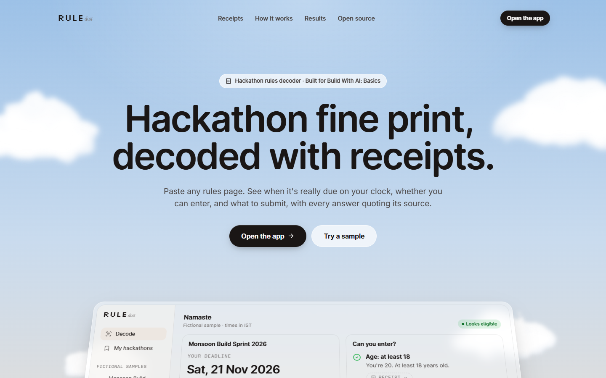
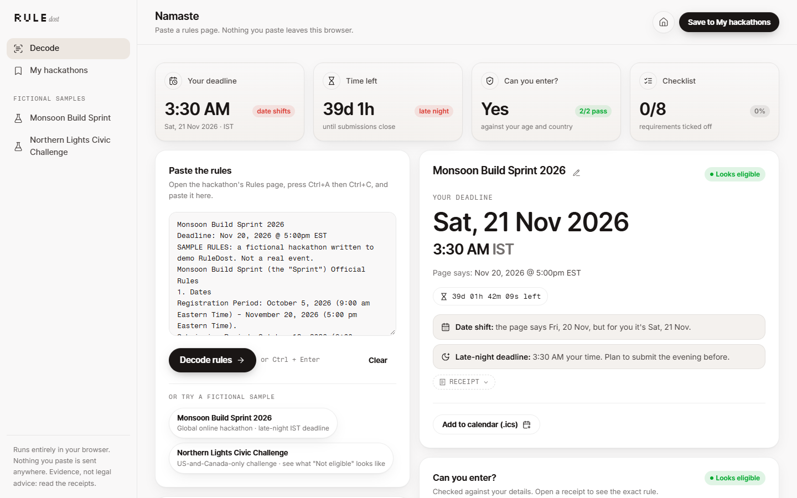
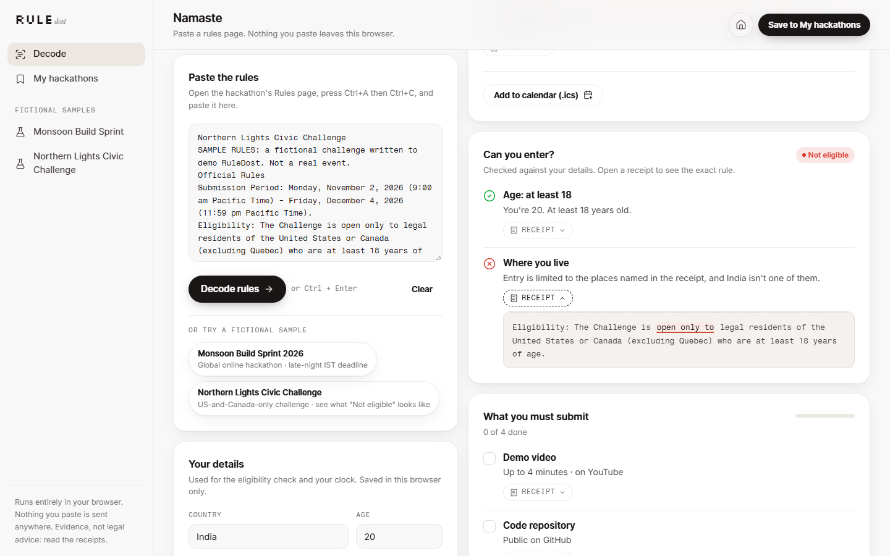
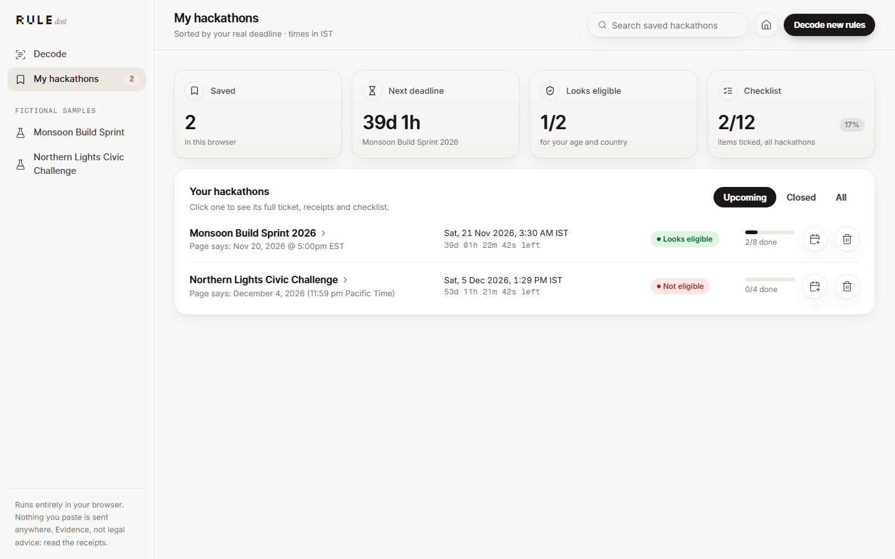

# RuleDost

**Paste a hackathon's rules page. Get your real deadline on your own clock, whether you can enter, and what you must submit. Every answer comes with a receipt: the exact sentence from the rules it came from.**

*"Dost" means friend in Hindi: the friend who actually reads the fine print.*

**Live app:** https://ruledost.vercel.app · **Demo video (2:36):** https://youtu.be/p5daJsw4q28



## The problem

Most online hackathons that Indian students enter are run from the US. The rules page says *"Deadline: Oct 26, 2026 @ 5:00pm EDT"*, which in Jaipur is **2:30 AM on Tuesday, 27 Oct**. Someone who plans for "Monday the 26th" is cutting it very close. The 13 rules pages on one student's list for October 2026 stated their deadlines in seven different time-zone labels (MSK, EDT, EST, PDT, PST, UTC, IST). Eligibility also changes from event to event: one excludes Italy and China, another is "open only to members of program X", and a third wants a licence visible in the repo's About section and specific files in the repo.

## What RuleDost does

1. **Your deadline, on your clock.** It finds the submission deadline, converts it to your time zone (IST by default) and shows a live countdown. It warns you when the date on the page isn't your date, or when the deadline lands in the middle of the night.
2. **Can you enter?** It checks the age rule, excluded or "open only to" countries, and special conditions against your age and country, and shows *Looks eligible*, *Check these* or *Not eligible*.
3. **What you must submit.** A tickable checklist: demo-video length and platform, repo host and visibility, licence, new-code rule, required files, required tech, description, testing access, English, disclosure. Remaining "must" sentences go in a separate group, and the prize is shown in USD and ₹ (Indian digit grouping).
4. **Receipts.** Every row has a *Receipt* toggle that quotes the sentence it came from, with the deciding phrase highlighted, so you can check RuleDost instead of trusting it.
5. **My hackathons.** Save decoded rules and see them sorted by your real deadline, with countdowns and checklist progress. *Add to calendar* downloads an `.ics` file with reminders 1 day and 3 hours before.

Decoding runs entirely in your browser. Nothing you paste is sent anywhere: there is no server, no account and no AI call at runtime. It is pattern matching you can check, by design.

| Decode | Not eligible, with the receipt open | My hackathons |
|---|---|---|
|  |  |  |

Phone layouts: [landing](docs/screenshots/landing-375.png) · [decode](docs/screenshots/app-decode-375.png) · [My hackathons](docs/screenshots/app-my-hackathons-375.png). There's also a [full landing page](docs/screenshots/landing-full-1440.jpg).

## Try it locally

Requirements: [Node.js](https://nodejs.org/) 20 or newer (22+ to run the tests).

```bash
git clone https://github.com/Thanatos9404/ruledost.git
cd ruledost
npm install
npm run dev          # → http://localhost:5173  (npm start does the same)
```

- `/` is the landing page and `/#app` is the app.
- Open a hackathon's **Rules** page, press <kbd>Ctrl</kbd>+<kbd>A</kbd> and <kbd>Ctrl</kbd>+<kbd>C</kbd>, paste into RuleDost, and press **Decode rules** (or <kbd>Ctrl</kbd>+<kbd>Enter</kbd>).
- Or open a clearly fictional sample: `/#sample=monsoon` (a global hackathon with a late-night IST deadline) or `/#sample=northern` (a US-and-Canada-only challenge that comes back *Not eligible* for India).
- Fill in *Your details* (country, age, time zone, ₹ per US$) to get the eligibility verdict. They are saved in this browser only.

Production build: `npm run build` writes a static site to `dist/`, and `npm run preview` serves it.

## Tests

```bash
npm test             # 54 unit tests on the decoder, Node's built-in runner
```

The tests cover time-zone parsing and conversion (EDT/EST/PT across DST, UTC offsets, MSK, IST, missing years), deadline and key-date extraction, eligibility (age, excluded and restricted countries, aliases such as "U.S."), checklist detectors, prize and INR formatting, storage (upsert, sorting, blocked storage) and `.ics` output (escaping, 75-octet folding, alarms). `npm run build` also type-checks the whole React app (TypeScript strict).

### Checking against real rules pages

```bash
npm run corpus -- path/to/folder-of-copied-rules.txt
```

This prints what RuleDost finds in each file. During the build it was run on 39 locally saved copies of real Devpost pages (Rules, Overview and Dates tabs of 13 hackathons). A deadline was found in all 39. On the 13 Rules pages, every deadline was checked by hand, and the age rule and country exclusion lists were found wherever the page states them. Real pages are other people's text, so they are **not** included in this repository.

## How it works

| Piece | Files | Job |
|---|---|---|
| Decoder | `src/lib/extract.js`, `src/lib/requirements.js`, `src/lib/text.js` | Pasted text → a "ticket" of facts, each with a receipt |
| Clock | `src/lib/time.js` | Reads dates, times and zone wordings; converts to one exact instant with the built-in `Intl` time-zone data |
| Judge | `src/lib/judge.js`, `src/lib/countries.js` | Compares eligibility facts with your age and country |
| Storage + calendar | `src/lib/store.js`, `src/lib/ics.js` | Profile and saved tickets in `localStorage` (memory fallback); RFC 5545 `.ics` with two reminders |
| App | `src/app/RuleDostApp.tsx`, `src/ui/TicketParts.tsx`, `src/ui/Receipt.tsx` | Decode, My hackathons and saved-ticket views in the kit's `AppShell`; receipts rendered as text, never pasted HTML |
| Landing | `src/landing/Landing.tsx` | Landing page whose previews are the real ticket components on decoded samples |
| UI kit | `src/kit/` | Shared design kit (see disclosure below) |

The decoder is plain JavaScript with no dependencies, and the tests import it directly. The React app imports the same modules, typed via the `.d.ts` files next to them. A longer walkthrough of the code is in [`devpost/app-map.html`](devpost/app-map.html).

**Time-zone notes.** An explicit abbreviation is taken literally (`EDT` = UTC−4 even in winter, because that is what the page says). Generic wording ("Eastern Time", "PT") follows the real daylight-saving rules for that date. Ambiguous abbreviations are read as IST = India, CST = US Central and BST = British Summer Time.

## Limits (honest ones)

- It is tuned for Devpost-style rules pages. Other formats still get receipts and "other must lines", but some rows will say *Check* instead of giving a verdict.
- "Age of majority" is read as 18, which is right for India and varies elsewhere. The row says so.
- The INR figure uses the rate you type in (default ₹88/US$). There is no live exchange rate.
- It shows evidence, not legal advice. Always read the receipts.

## Deploying (optional)

It is a static site: `npm run build` produces `dist/`, with no server and no environment variables.
- **Vercel:** import the repo. `vercel.json` sets the build (`npm run build`), the output directory (`dist`) and security headers, including a Content-Security-Policy that was tested against the production build.
- **Netlify:** build command `npm run build`, publish directory `dist`.
- **GitHub Pages:** publish the contents of `dist/`. The build uses relative asset paths and hash routes, so a sub-path works.

## How it was built

RuleDost was made for **Build With AI: Basics** (Devpost, Sept–Oct 2026), starting from an empty folder with the [Devpost Learn skill pack](https://github.com/challengepost/learn-ai-basics) (`npx skills add challengepost/learn-ai-basics --all -y`). The planning documents that process generated are in [`devpost/`](devpost/): [`scope.md`](devpost/scope.md), [`prd.md`](devpost/prd.md) and [`spec.md`](devpost/spec.md), plus the build checklist [`checklist.md`](devpost/checklist.md). The checklist records each slice, the later UI rebuild, and every place the build changed the plan. `skills-lock.json` records the skill-pack version used.

**Stack:** React 18, Vite 6, TypeScript, Tailwind CSS v4, Motion, Lenis, Lucide icons, and self-hosted OFL fonts (Open Runde, Inter, Instrument Serif, Fragment Mono, Silkscreen) via Fontsource. Everything is bundled and nothing loads from a CDN.

**Disclosure:**
- The planning documents and code were written with Claude Code (an AI coding agent) working from Yashvardhan's brief, and the docs record which decisions were delegated to the agent.
- `src/kit/` is copied unchanged from Yashvardhan's shared design kit for his October 2026 hackathon projects. That kit was created on 12 Oct 2026, during the submission period. Its visual language is inspired by the obliqq Framer template (style only; no assets copied).
- No other pre-existing code is included. Third-party packages are listed in `package.json` under their own licences.

## License

[MIT](LICENSE) © 2026 Yashvardhan Thanvi
