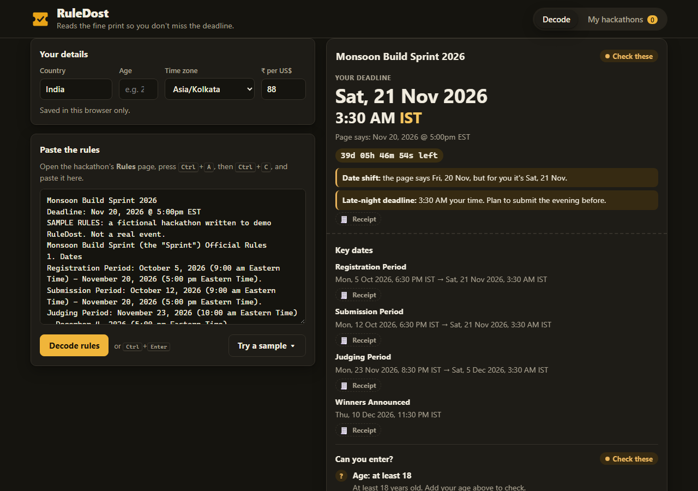
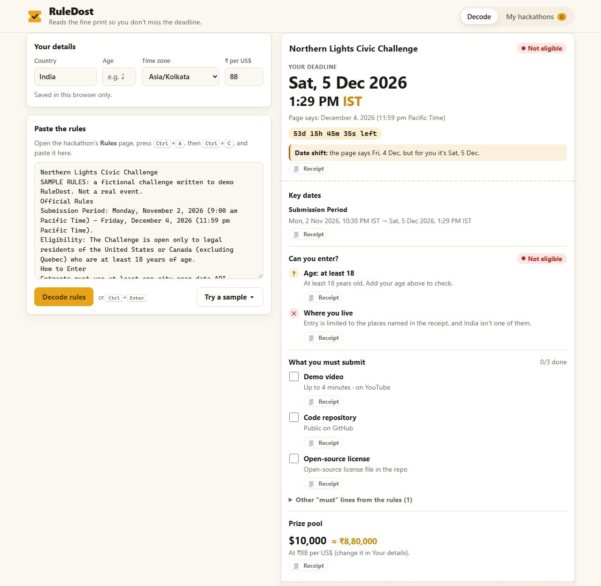

# RuleDost

**Paste a hackathon's rules page. Get your real deadline on your own clock, whether you can enter, and what you must submit. Every answer comes with a receipt: the exact sentence from the rules it came from.**

*"Dost" means friend in Hindi: the friend who actually reads the fine print.*



## The problem

Most online hackathons that Indian students enter are run from the US. The rules page says *"Deadline: Oct 26, 2026 @ 5:00pm EDT"*, which in Jaipur is **2:30 AM on Tuesday, 27 Oct**. Someone who plans for "Monday the 26th" is cutting it very close. The same pages run to 30 KB of legal text, and eligibility changes from event to event. One event excludes Italy and China, another is "open only to members of program X", a third wants a licence visible in the repo's About section and specific files in the repo.

## What RuleDost does

1. **Your deadline, on your clock.** It finds the submission deadline, converts it to your time zone (IST by default) and shows a live countdown. It warns you when the date on the page isn't your date, or when the deadline lands in the middle of the night.
2. **Can you enter?** It checks the age rule, excluded or "open only to" countries, and special conditions against your age and country, and shows *Looks eligible*, *Check these* or *Not eligible*.
3. **What you must submit.** A tickable checklist: demo-video length and platform, repo host and visibility, licence, new-code rule, required files, required tech, description, testing access, English, disclosure. Remaining "must" sentences go in a separate group, and the prize is shown in USD and ₹ (Indian digit grouping).
4. **Receipts.** Every row has a *Receipt* toggle that quotes the sentence it came from, with the deciding phrase highlighted, so you can check RuleDost instead of trusting it.
5. **My hackathons.** Save decoded rules and see them sorted by your real deadline, with countdowns and checklist progress. *Add to calendar* downloads an `.ics` file with reminders 1 day and 3 hours before.

Everything runs in your browser. Nothing you paste is sent anywhere: there is no server, no account and no AI call at runtime. It is pattern matching you can check, by design.



## Try it locally

Requirements: [Node.js](https://nodejs.org/) 20 or newer (22+ to run the tests). There are no dependencies, so there's nothing to install.

```bash
git clone https://github.com/Thanatos9404/ruledost.git
cd ruledost
npm start            # → http://localhost:5173
```

Then either:
- open a hackathon's **Rules** page, press <kbd>Ctrl</kbd>+<kbd>A</kbd> and <kbd>Ctrl</kbd>+<kbd>C</kbd>, paste into RuleDost, and press **Decode rules** (or <kbd>Ctrl</kbd>+<kbd>Enter</kbd>); or
- click **Try a sample** for one of two clearly fictional rules pages. You can also open `http://localhost:5173/#sample=monsoon` or `#sample=northern` directly.

Fill in *Your details* (country, age, time zone, ₹ per US$) to get the eligibility verdict. They are saved in this browser only.

> The page uses ES modules, which browsers won't load from `file://`. Use `npm start` (or any static server) rather than double-clicking `index.html`.

## Tests

```bash
npm test             # 54 unit tests, Node's built-in runner, no dependencies
```

The tests cover time-zone parsing and conversion (EDT/EST/PT across DST, UTC offsets, MSK, IST, missing years), deadline and key-date extraction, eligibility (age, excluded and restricted countries, aliases such as "U.S."), checklist detectors, prize and INR formatting, storage (upsert, sorting, blocked storage) and `.ics` output (escaping, 75-octet folding, alarms).

### Checking against real rules pages

```bash
npm run corpus -- path/to/folder-of-copied-rules.txt
```

This prints what RuleDost finds in each file. During the build it was run on 39 locally saved copies of real Devpost pages (Rules, Overview and Dates tabs of 13 hackathons). A deadline was found in all 39. On the 13 Rules pages, every deadline was checked by hand, and the age rule and country exclusion lists were found wherever the page states them. Real pages are other people's text, so they are **not** included in this repository.

## How it works

| Piece | File | Job |
|---|---|---|
| Decoder | `src/lib/extract.js`, `src/lib/requirements.js` | Pasted text → a "ticket" of facts, each with a receipt |
| Clock | `src/lib/time.js` | Reads dates, times and zone wordings; converts to one exact instant with the built-in `Intl` time-zone data |
| Judge | `src/lib/judge.js`, `src/lib/countries.js` | Compares eligibility facts with your age and country |
| Page | `index.html`, `styles.css`, `src/app.js`, `src/ui/render.js` | Draws the ticket (text nodes only, never pasted HTML) |
| Storage | `src/lib/store.js` | Profile and saved tickets in `localStorage`, with a memory fallback |
| Calendar | `src/lib/ics.js` | RFC 5545 `.ics` with two reminders |

A longer walkthrough is in [`devpost/app-map.html`](devpost/app-map.html).

**Time-zone notes.** An explicit abbreviation is taken literally (`EDT` = UTC−4 even in winter, because that is what the page says). Generic wording ("Eastern Time", "PT") follows the real daylight-saving rules for that date. Ambiguous abbreviations are read as IST = India, CST = US Central and BST = British Summer Time.

## Limits (honest ones)

- It is tuned for Devpost-style rules pages. Other formats still get receipts and "other must lines", but some rows will say *Check* instead of giving a verdict.
- "Age of majority" is read as 18, which is right for India and varies elsewhere. The row says so.
- The INR figure uses the rate you type in (default ₹88/US$). There is no live exchange rate.
- It shows evidence, not legal advice. Always read the receipts.

## Deploying (optional)

It is a static site with no build step and no environment variables.
- **Vercel:** import the repo, choose the framework preset *Other*, leave the build command empty and set the output directory to `.`. `vercel.json` adds security headers.
- **Netlify:** set the publish directory to `.` with no build command.
- **GitHub Pages:** serve from the repository root.

## How it was built

RuleDost was made for **Build With AI: Basics** (Devpost, Sept–Oct 2026), starting from an empty folder with the [Devpost Learn skill pack](https://github.com/challengepost/learn-ai-basics) (`npx skills add challengepost/learn-ai-basics --all -y`). The planning documents that process generated are in [`devpost/`](devpost/): [`scope.md`](devpost/scope.md), [`prd.md`](devpost/prd.md) and [`spec.md`](devpost/spec.md), plus the build checklist [`checklist.md`](devpost/checklist.md). The checklist records each slice and every place the build changed the plan. `skills-lock.json` records the skill-pack version used.

**AI disclosure:** the planning documents and code were written with Claude Code (an AI coding agent) working from Yashvardhan's brief, and the docs record which decisions were delegated to the agent. No pre-existing code was reused. There are no third-party runtime libraries.

## License

[MIT](LICENSE) © 2026 Yashvardhan Thanvi
